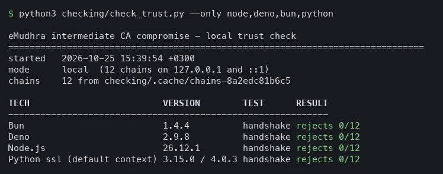

# eMudhra macOS checker

Does Mac still trust the compromised eMudhra intermediate CAs?

In October 2026, eight eMudhra intermediate CA keys turned out to be recoverable
from their public certificates. This repo asks each installed TLS client to complete a real handshake against a certificate issued under one of those CAs, locally.

Background: [disclosure site](https://emudhra.we-have-a-problem.com/) ·
[source](https://github.com/galadran/we-have-a-problem.com).

## Run

```sh
python3 checking/check_trust.py
```




## Requirements

macOS, Python 3 (standard library only), `openssl` on `PATH`. `codesign` only
for the patcher.


## Also here

- Distrust the 14 compromised intermediates in the keychain:
  `python3 checking/distrust_keychain.py` sets Never Trust per certificate,
  asking first. `--admin` uses the System keychain, `--undo` reverts,
  `--list` shows state. Chromium on macOS honors local distrust, which should
  cover Chrome, Edge, Brave, Opera, Vivaldi, Yandex and Electron apps that use
  the system verifier.
- Check from inside Sublime: `python3 checking/serve_lab.py --install-plugin`,
  then “eMudhra: check local trust”.
- Patch Sublime: `python3 checking/patch_sublime.py` swaps its bundled certifi
  and re-signs ad-hoc.

## About the keys

Included so the tool runs locally. They are derivable from the public
certificates in milliseconds, so this adds no exposure.

`keys/emudhra-intermediate-ca-keys.zip` repackages the public
`emudrahahahahaha` repository (commit `c43b3f0`)
